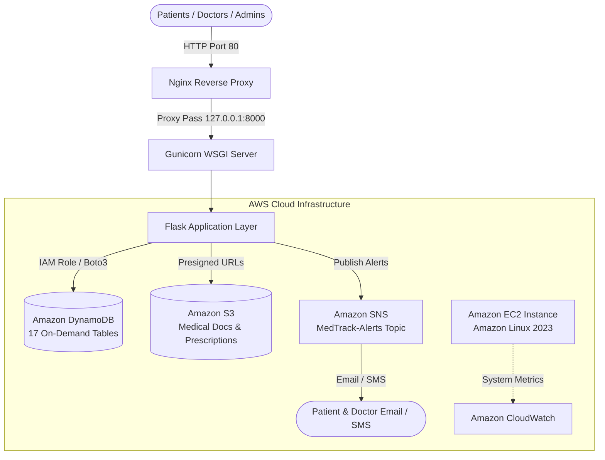

# MedTrack - AWS Cloud Practitioner Capstone Project

[](https://www.python.org/)
[](https://flask.palletsprojects.com/)
[](https://aws.amazon.com/dynamodb/)
[](https://aws.amazon.com/s3/)
[](https://aws.amazon.com/sns/)
[](https://aws.amazon.com/ec2/)
[]()

**MedTrack** is a production-grade, highly available Cloud Healthcare Management System built as an AWS Cloud Practitioner Capstone project. It implements a secure, scalable, multi-tenant architecture designed to manage patient health records, appointment scheduling with concurrency controls, digital prescriptions, and automated real-time alert notifications.

---

## 🏗️ Architecture & AWS Cloud Services



### AWS Services Utilized
* **Amazon EC2 (Elastic Compute Cloud):** Hosts the web application on Amazon Linux 2023 (`t2.micro` / `t3.micro`) managed with Systemd and Nginx.
* **Amazon DynamoDB:** Fully serverless NoSQL database operating in On-Demand mode (`PAY_PER_REQUEST`). Employs partition/sort keys, Global Secondary Indexes (GSIs), and `TransactWriteItems` for double-booking prevention.
* **Amazon S3 (Simple Storage Service):** Secure object storage for patient medical documents and dynamic PDF prescriptions, secured via time-limited Presigned URLs.
* **Amazon SNS (Simple Notification Service):** Publishes real-time transactional alerts (OTP verification, appointment booking, and status updates) directly to patient/doctor emails and SMS.
* **AWS IAM (Identity and Access Management):** Enforces least-privilege instance profiles (`MedTrack-EC2-Role` / `LabRole`) with zero hardcoded credentials in the code.
* **Amazon CloudWatch:** Monitors server health, memory utilization, disk space, and application logs.

---

## 🗄️ DynamoDB Table Schema Reference

MedTrack uses **17 DynamoDB tables**. The table names use the prefix `MedTrack-` by default (configurable via `DYNAMODB_PREFIX`).

| Table Name | Partition Key (PK) | Sort Key (SK) | Global Secondary Indexes (GSIs) | Purpose |
| :--- | :--- | :--- | :--- | :--- |
| **`MedTrack-Users`** | `UserID` (String) | *None* | `email-index` (PK: `Email`)<br>`role-index` (PK: `Role`) | Authentication, credentials, RBAC roles |
| **`MedTrack-Patients`** | `PatientID` (String) | *None* | `email-index` (PK: `Email`) | Patient demographic & emergency profiles |
| **`MedTrack-Doctors`** | `DoctorID` (String) | *None* | `email-index` (PK: `Email`)<br>`specialization-index` (PK: `SpecializationID`)<br>`status-index` (PK: `Status`) | Doctor profiles, approvals, specialties |
| **`MedTrack-DoctorAvailability`** | `DoctorID` (String) | `Date` (String) | *None* | Doctor working schedules & available time slots |
| **`MedTrack-Appointments`** | `AppointmentID` (String) | *None* | `patient-index` (PK: `PatientID`, SK: `ScheduledAt`)<br>`doctor-index` (PK: `DoctorID`, SK: `ScheduledAt`)<br>`status-index` (PK: `Status`) | Scheduled appointments & slot lock states |
| **`MedTrack-Prescriptions`** | `PrescriptionID` (String) | *None* | `patient-index` (PK: `PatientID`)<br>`appointment-index` (PK: `AppointmentID`)<br>`doctor-index` (PK: `DoctorID`) | Digital prescriptions & medicines |
| **`MedTrack-DiagnosisReports`** | `ReportID` (String) | *None* | `patient-index` (PK: `PatientID`)<br>`appointment-index` (PK: `AppointmentID`) | Consultation diagnosis and private notes |
| **`MedTrack-MedicalDocuments`** | `DocumentID` (String) | *None* | `patient-index` (PK: `PatientID`) | Metadata for uploaded lab reports in S3 |
| **`MedTrack-Vitals`** | `PatientID` (String) | `RecordedAt` (String) | *None* | BP, glucose, heart rate, and BMI timeline |
| **`MedTrack-Invoices`** | `InvoiceID` (String) | *None* | `patient-index` (PK: `PatientID`)<br>`status-index` (PK: `Status`) | Consultation billing & payment tracking |
| **`MedTrack-Reviews`** | `ReviewID` (String) | *None* | `doctor-index` (PK: `DoctorID`)<br>`patient-index` (PK: `PatientID`) | Patient feedback and doctor ratings |
| **`MedTrack-Notifications`** | `NotificationID` (String) | *None* | `user-index` (PK: `UserID`, SK: `CreatedAt`) | In-app user notification history |
| **`MedTrack-SupportTickets`** | `TicketID` (String) | *None* | `user-index` (PK: `UserID`)<br>`status-index` (PK: `Status`) | User help desk and contact inquiries |
| **`MedTrack-AuditLogs`** | `LogID` (String) | *None* | `user-index` (PK: `UserID`, SK: `Timestamp`) | Immutable security compliance audit trail |
| **`MedTrack-LoginHistory`** | `UserID` (String) | `LoginAt` (String) | *None* | IP address, user-agent, and login tracking |
| **`MedTrack-Specializations`** | `SpecializationID` (String) | *None* | *None* | Medical categories (Cardiology, Pediatrics, etc.) |
| **`MedTrack-SiteContent`** | `ContentKey` (String) | *None* | *None* | Configurable dynamic site content |

> **Automated Table Creation:** Rather than creating all 17 tables manually in the AWS Console, MedTrack includes a script (`scripts/create_tables.py`) that provisions all 17 tables with their exact Partition Keys, Sort Keys, and GSIs automatically using the AWS Boto3 SDK!

---

## 🚀 Step-by-Step AWS Deployment Guide (SkillWallet / Lab Friendly)

Follow this structured guide to deploy MedTrack directly inside your AWS Lab environment.

### Step 1: Create IAM Role for EC2
1. In the AWS Management Console, navigate to **IAM** → **Roles** → **Create role**.
   *(Note: If your lab already provides a pre-configured `LabRole`, you can use it directly and skip to Step 2).*
2. **Trusted entity type:** Select **AWS service**.
3. **Use case:** Select **EC2**, then click **Next**.
4. **Permissions policies:** Search and attach the following policies:
   - `AmazonDynamoDBFullAccess`
   - `AmazonSNSFullAccess`
   - `AmazonS3FullAccess`
   - `CloudWatchAgentServerPolicy`
5. **Role name:** Enter `MedTrack-EC2-Role` and click **Create role**.

---

### Step 2: Set Up DynamoDB Tables
You can create your primary table in the AWS Console to satisfy manual lab checklist steps, then run the automated script to provision the rest:

#### Manual Table (Lab Checklist)
1. Open the **Amazon DynamoDB** console and click **Create table**.
2. **Table name:** `MedTrack-Users`
3. **Partition key:** `UserID` (Type: `String`)
4. **Table settings:** Select **Custom settings** → **On-demand** capacity.
5. Click **Create table**.

*(The remaining 16 tables will be created automatically in Step 5 using `python scripts/create_tables.py`).*

---

### Step 3: Set Up SNS Topic and Subscription
1. Open the **Amazon SNS** console and click **Topics** → **Create topic**.
2. **Type:** Select **Standard**.
3. **Name:** Enter `MedTrack-Alerts`.
4. Click **Create topic**.
5. Copy the generated **Topic ARN** (e.g., `arn:aws:sns:us-east-1:123456789012:MedTrack-Alerts`).
6. In the topic page, click **Create subscription**:
   - **Protocol:** Select `Email`.
   - **Endpoint:** Enter your personal or lab email address.
   - Click **Create subscription**.
7. **Confirm Subscription:** Open your email inbox, find the AWS Notification confirmation email, and click **Confirm subscription**.

---

### Step 4: S3 Bucket (Optional - Skip if no permission in Lab)
> **Note for Student Labs:** If your learner lab policy does not permit creating S3 buckets (`AccessDenied`), **simply skip this step!** MedTrack includes an automated local disk storage fallback (`uploads/`) on EC2 so all medical document uploads and prescription PDFs will work 100% smoothly without an S3 bucket.
> 
> *If your lab permits S3:*
> 1. Open **Amazon S3** → **Create bucket**.
> 2. **Bucket name:** `medtrack-documents-<unique-id>`.
> 3. Click **Create bucket**.

---

### Step 5: Launch the EC2 Instance
1. Open the **Amazon EC2** console and click **Launch instance**:
   - **Name:** `MedTrack-Server`
   - **Application and OS Images:** Select **Amazon Linux 2023 AMI** (Free Tier eligible).
   - **Instance type:** `t2.micro` or `t3.micro`.
   - **Key pair:** Proceed without a key pair (or select an existing key pair).
2. **Network settings:**
   - Check **Allow HTTP traffic from the internet** (Port 80).
   - Check **Allow SSH traffic from** (Port 22, My IP).
3. **Advanced details:**
   - **IAM instance profile:** Select `MedTrack-EC2-Role` (or `LabRole`).
4. Click **Launch instance**.

---

### Step 6: Deploy GitHub Source Code to EC2

1. Once the instance status is **Running**, select it and click **Connect** → **EC2 Instance Connect** → **Connect**.
2. Run the deployment commands in the terminal:

```bash
# 1. Update system packages and install dependencies
sudo dnf update -y
sudo dnf install -y git nginx python3.11 python3.11-pip

# 2. Clone repository into /opt/medtrack
sudo mkdir -p /opt/medtrack
sudo chown -R ec2-user:ec2-user /opt/medtrack
git clone https://github.com/SAM18-Bot/MedTrack.git /opt/medtrack
cd /opt/medtrack

# 3. Create virtual environment and install packages
python3.11 -m venv venv
source venv/bin/activate
pip install --upgrade pip
pip install -r requirements.txt

# 4. Configure environment variables
cp .env.example .env

# Generate a secure Flask SECRET_KEY
RANDOM_SECRET=$(python3 -c "import secrets; print(secrets.token_hex(32))")
sed -i "s/SECRET_KEY=.*/SECRET_KEY=${RANDOM_SECRET}/" .env
sed -i "s/FLASK_ENV=.*/FLASK_ENV=production/" .env
```

3. Update `.env` with your S3 Bucket and SNS ARN:
```bash
nano .env
```
Ensure the following variables match your AWS setup:
```ini
AWS_DEFAULT_REGION=us-east-1
DYNAMODB_PREFIX=MedTrack-
S3_BUCKET_NAME=your-bucket-name-here
SNS_TOPIC_ARN=your-sns-topic-arn-here
```
*(Press `Ctrl+O`, `Enter`, then `Ctrl+X` to save and exit).*

4. Provision all DynamoDB tables and seed the initial Admin account:
```bash
python scripts/create_tables.py
python scripts/seed_admin.py
```

5. Configure Nginx and Systemd services:
```bash
# Configure Nginx reverse proxy
sudo cp deploy/nginx.conf /etc/nginx/conf.d/medtrack.conf
sudo systemctl restart nginx
sudo systemctl enable nginx

# Configure MedTrack background service
sudo cp deploy/medtrack.service /etc/systemd/system/medtrack.service
sudo systemctl daemon-reload
sudo systemctl enable medtrack
sudo systemctl start medtrack
```

6. Verify that the services are active:
```bash
sudo systemctl status medtrack
sudo systemctl status nginx
```

🎉 **MedTrack is now LIVE!** Open your browser and navigate to:
```
http://<YOUR-EC2-PUBLIC-IP>
```

---

## 🔑 Default Seeded Admin Credentials

After running `python scripts/seed_admin.py`, log in at `http://<YOUR-EC2-PUBLIC-IP>/auth/login`:
* **Email:** `admin@medtrack.local`
* **Password:** `Admin@123!`

---

## 📂 Repository File Structure

```text
MedTrack/
├── app/
│   ├── blueprints/           # Modular route controllers
│   │   ├── admin.py          # Admin portal, doctor approvals, audit logs
│   │   ├── api.py            # REST API endpoints & health checks
│   │   ├── auth.py           # Login, registration, MFA/OTP, password resets
│   │   ├── doctor.py         # Consultations, prescriptions, earnings, reviews
│   │   ├── patient.py        # Booking, vitals, medical records, invoices
│   │   ├── public.py         # Landing page, doctor directory, contact form
│   │   └── support.py        # Support ticketing system
│   ├── forms/                # WTForms schemas with regex validation
│   ├── repositories/         # DynamoDB data access layer & retry wrappers
│   ├── services/             # Business logic (Auth, Notifications, Storage, PDF)
│   ├── static/               # CSS, JavaScript (Chart.js), and branding assets
│   ├── templates/            # Jinja2 HTML templates for all portals
│   ├── config.py             # Flask configuration & security controls
│   └── extensions.py         # Flask-WTF CSRF and Flask-Limiter extensions
├── deploy/
│   ├── medtrack.service      # Systemd service definition for Gunicorn
│   └── nginx.conf            # Nginx reverse proxy configuration
├── iam/
│   └── ec2_instance_profile.json # Least-privilege IAM policy reference
├── infra/
│   ├── cloudwatch-agent.json # CloudWatch metrics collection configuration
│   └── ec2-bootstrap.sh      # Automated EC2 user-data initialization script
├── scripts/
│   ├── create_tables.py      # Automated DynamoDB 17-table schema generator
│   └── seed_admin.py         # Initial administrative account seeder
├── tests/                    # Pytest test suite with Moto AWS mocking (28 tests)
├── gunicorn_config.py        # Production WSGI worker configuration
├── requirements.txt          # Python project dependencies
├── run.py                    # Application entry point
└── README.md                 # Project documentation
```

---

## 🧪 Automated Testing

MedTrack includes 28 unit and integration tests using `pytest` and `moto` to test DynamoDB transactions, RBAC authorization, and ownership layers offline.

To run tests locally:
```bash
pytest -v
```
Output:
```text
============================= test session starts =============================
tests/test_admin.py ...                                                  [ 10%]
tests/test_auth.py ...                                                   [ 21%]
tests/test_aws_services.py .                                             [ 25%]
tests/test_concurrency.py .                                              [ 28%]
tests/test_db.py ..                                                      [ 35%]
tests/test_doctor.py ..                                                  [ 42%]
tests/test_ownership.py .....                                            [ 60%]
tests/test_patient.py ....                                               [ 75%]
tests/test_public.py ..                                                  [ 82%]
tests/test_roles.py ...                                                  [ 92%]
tests/test_scaffold.py ..                                                [100%]
============================= 28 passed in 37.70s =============================
```

---

## 📄 License
This project is licensed under the MIT License - built for educational and Capstone demonstration purposes.
